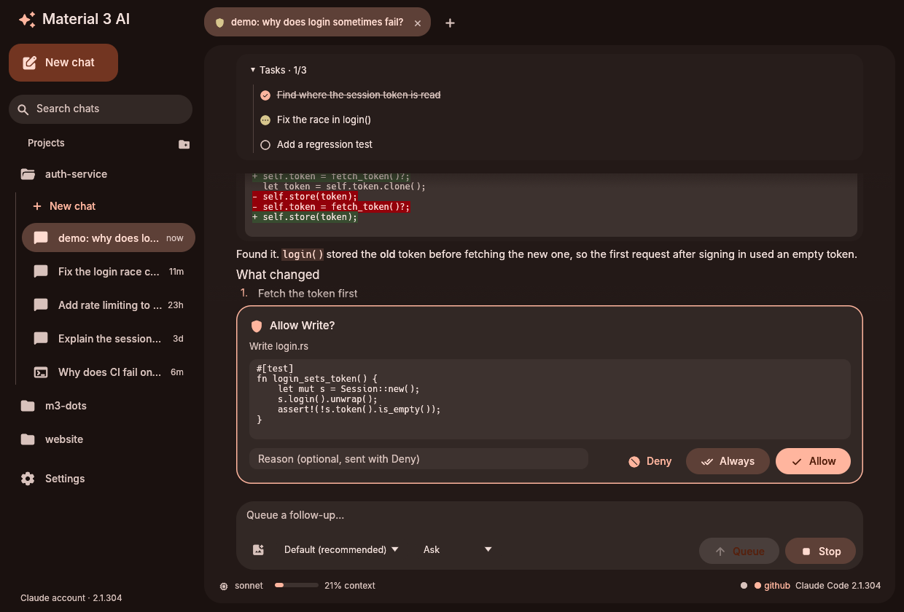
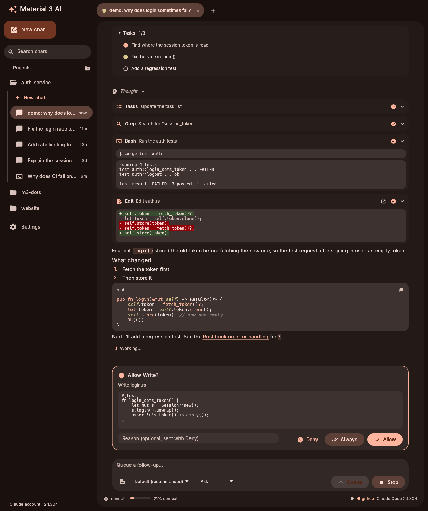
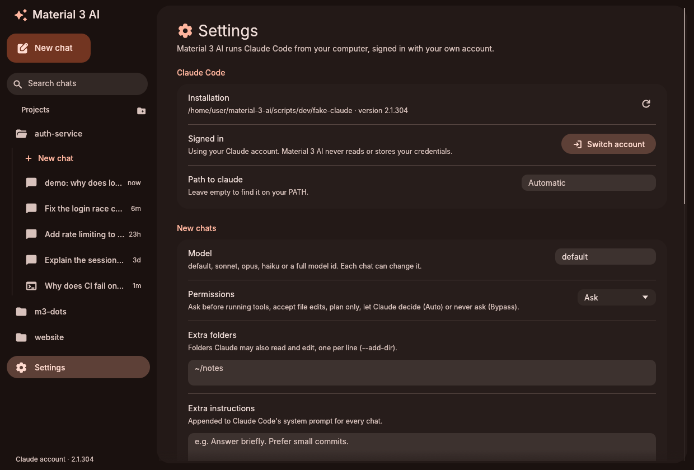
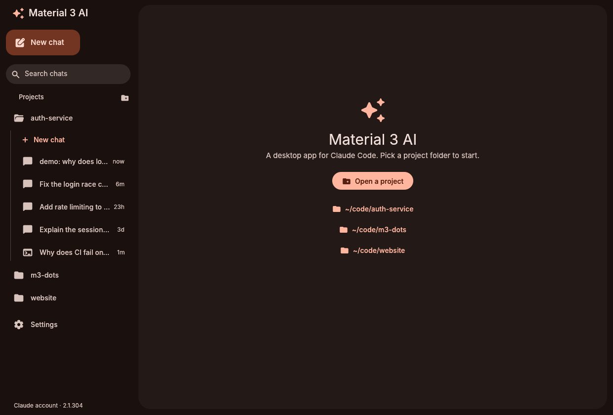

# Material 3 AI

A desktop app for [Claude Code](https://code.claude.com/docs), built with [egui](https://github.com/emilk/egui) and themed with Material You. It shares its look, widgets and fonts with the [Material 3 File Manager](https://github.com/bhimio1/material-3-file-manager-rust) and [Material 3 Settings](https://github.com/bhimio1/material-3-settings), and on an end-4 desktop it takes its colors from your wallpaper, like the shell does.

Material 3 AI runs the `claude` command you already have installed and signed in. It is a window around Claude Code, not a replacement for it: every model call, tool, permission rule, MCP server, hook and `CLAUDE.md` is Claude Code's own.






## Features

**Chats**
- **Projects:** add folders, then start chats in them. Each project lists its chats, including ones you started in Claude Code in a terminal, which you can open and continue.
- **Tabs:** several chats at once, each with its own `claude` process. A tab shows a spinner while Claude works and a shield while it waits for you.
- **Search** chat titles from the sidebar.
- **Markdown** replies with headings, lists, tables, links and syntax-highlighted code blocks with a copy button. Replies stream in as they're written. Thinking is shown collapsed.
- **Tool cards:**
  - Bash: the command and its output;
  - Read, Write, Edit and MultiEdit: the file, with a diff for edits;
  - Grep and Glob: the pattern and matches;
  - WebFetch and WebSearch;
  - Task and Agent: the subagent's own steps nested inside;
  - MCP tools: the server, the tool and its result.

  Errors are marked, and long output is folded.
- **Task list:** Claude's TodoWrite list is pinned above the chat.

**Permissions**
- When Claude wants to use a tool, a card shows what it will do (the command, or the diff it will write).
- **Allow**, **Always** or **Deny**, or press <kbd>Y</kbd>, <kbd>A</kbd> or <kbd>N</kbd>.
  - **Always** saves the rule Claude Code suggests.
  - **Deny** can include a reason, which is sent back to Claude.
- Pick the permission mode per chat: Ask, Accept edits, Plan, Auto or Bypass. Bypass shows a warning.

**Message box**
- <kbd>Enter</kbd> sends, <kbd>Shift</kbd>+<kbd>Enter</kbd> adds a new line, and <kbd>Esc</kbd> stops Claude.
- Messages you send while Claude is working are queued and go out in order.
- **Images:** attach with the button, drag and drop, or paste with <kbd>Ctrl</kbd>+<kbd>V</kbd>. Large images are scaled down first.
- Type `/` for slash commands (built-in, your own, and from plugins) and `@` for files in the project. Dropping a file that isn't an image inserts its `@path`.
- Switch the model for the chat at any time.

**Status bar:** model, how full the context window is, cost so far, tokens, MCP server status, and the Claude Code version.

**Settings**
- **Claude Code:** where `claude` is, its version, and whether you're signed in. **Sign in** opens a terminal running Claude Code's own login.
- **New chats:** default model and permission mode, extra folders (`--add-dir`), extra instructions for the system prompt, and an MCP servers file (`--mcp-config`).
- **Appearance:** color source, light/dark, seed color, chat text size, filled icons and interface scale.
- **Notifications:** a desktop notification when a reply finishes, or when Claude needs permission while the window isn't focused. Clicking it brings the window back.

## Requirements

- [Claude Code](https://code.claude.com/docs/en/setup), installed and signed in. Install it from the AUR (`claude-code`) or with the official installer. Material 3 AI looks for `claude` on your `PATH`, in `~/.local/bin`, `~/.claude/local` and `~/.npm-global/bin`, or you can set the path in Settings.
- `xdg-desktop-portal` for the folder and image pickers. Without it, you can type a folder path instead.
- A notification server (your desktop shell's, mako, dunst, …) for notifications. This is optional.

## Your account and credentials

Material 3 AI never reads, stores or sends your credentials. It starts your own unmodified `claude` binary, talks to it over its documented `stream-json` input and output (the same protocol as the Claude Agent SDK), and checks sign-in with `claude auth status --json`. Signing in happens in Claude Code's own login, in a terminal.

Usage counts against whatever account or API key Claude Code is signed in with, exactly as it would in a terminal.

## Name

Material 3 AI is an independent project. It is not affiliated with or endorsed by Anthropic. "Claude" and "Claude Code" are Anthropic's. The app says it runs Claude Code, but doesn't use those names or Anthropic's logos as its own name or icon.

## Install

From the AUR, prebuilt or built from source:

```sh
paru -S material-3-ai-bin   # or material-3-ai-git
```

From this repository, with the included PKGBUILD:

```sh
cd packaging
makepkg -si
```

Prebuilt x86_64 binaries are attached to [releases](https://github.com/bhimio1/material-3-ai/releases).

Or build directly:

```sh
cargo build --release
./target/release/m3-ai [DIR]
```

```
m3-ai [DIR]                 open a new chat in DIR (or the welcome page)
m3-ai [DIR] --resume ID     continue a Claude Code session
```

Bind it in Hyprland (end-4: `~/.config/hypr/custom/keybinds.lua`):

```lua
hl.bind("SUPER + C", hl.dsp.exec_cmd("m3-ai"))
```

Shortcuts: <kbd>Ctrl</kbd>+<kbd>N</kbd> new chat, <kbd>Ctrl</kbd>+<kbd>,</kbd> settings, middle-click a tab to close it.

## Theme

In Settings, **Auto** uses the end-4 shell's generated colors (`~/.local/state/quickshell/user/generated/colors.json`). If those don't exist it uses the file manager's matugen `theme.json`, and otherwise a seed color. The theme updates live when the wallpaper changes.

## Files

- Preferences: `~/.config/m3-ai/config.toml` (appearance under `[appearance]`, shared with the other Material 3 apps; older top-level `theme_source`, `color_scheme`, … settings are carried over).
- Chat list: `~/.local/share/m3-ai/sessions.json`. This holds titles, folders and costs only.
- Transcripts stay where Claude Code keeps them (`~/.claude/projects`).

## Development

`scripts/dev/fake-claude` is a small stand-in for `claude` that speaks the same protocol without calling a model. Use it to work on the interface without spending anything:

```sh
M3_AI_CLAUDE=scripts/dev/fake-claude cargo run -- ~/code/some-project
```

Prompts the stub understands:

| Prompt contains | What the stub does |
| --- | --- |
| `demo` | a full turn: thinking, a task list, Grep, a failing Bash run, an edit, markdown, then a permission request |
| `permission` | asks to run a Bash command |
| `slow` | streams until you press Stop |
| anything else | a short reply |

Development variables:

| Variable | Effect |
| --- | --- |
| `M3_AI_CLAUDE` | the `claude` binary to run |
| `M3_AI_DEMO_PROMPT` | a prompt sent to the first chat on start |
| `M3_AI_PAGE=settings` | open on Settings |
| `M3_AI_WINDOW=WxH` | starting window size |

Run the tests with `cargo test`. They include a full session against the stub. One test is ignored by default: it runs the real `claude` and checks the initialize handshake, without sending a prompt.

```sh
cargo test -- --ignored real_claude
```

## Project layout

```
src/
  app.rs        app state, theme, tabs, layout, action dispatch
  chat.rs       one chat: its claude process, composer, queue and events
  config.rs     preferences
  images.rs     image attachments (files, clipboard, scaling)
  claude/
    protocol.rs   stream-json messages and control requests
    process.rs    spawning claude and the reader threads
    conversation.rs  turning events into chat items
    index.rs      the chat list and Claude Code's transcripts
    info.rs       version and sign-in status
  sys/          portal pickers
  ui/           sidebar, chat, composer, tool cards, code highlighting, settings
scripts/dev/fake-claude   protocol stub for development and tests
```

The palette, egui style, fonts, widgets, page scaffolding, toasts, Markdown rendering, notifications and system helpers come from the shared [material-3-ui](https://github.com/bhimio1/material-3-ui) crate; syntect's grammars plug into its Markdown renderer for code.

## License

MIT, see [LICENSE](LICENSE).

Fonts: Inter (SIL OFL 1.1, see `assets/fonts/LICENSE-Inter.txt`). Icons: Material Symbols, via `egui_material_icons` (both bundled through material-3-ui).
